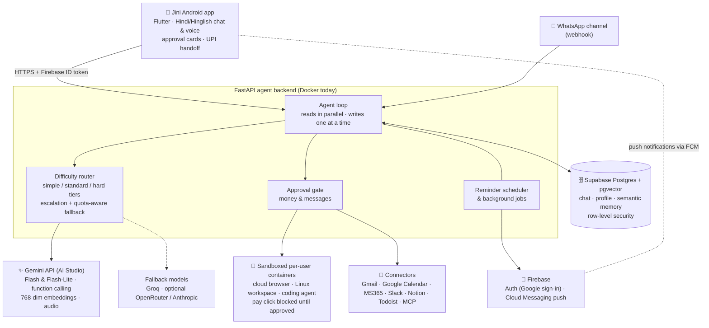
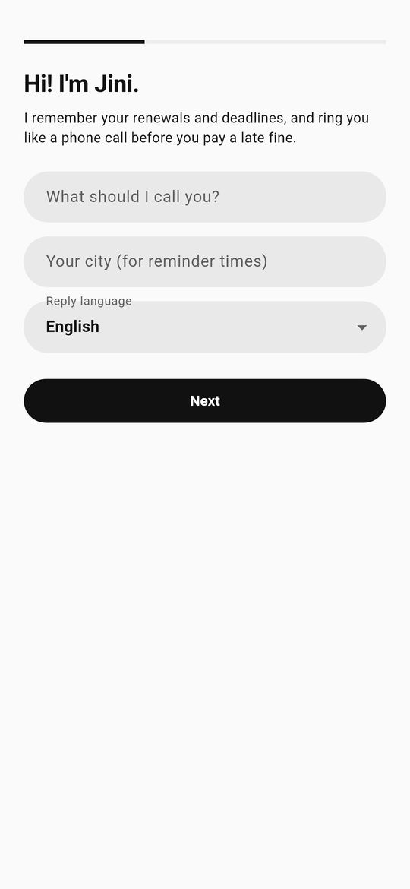
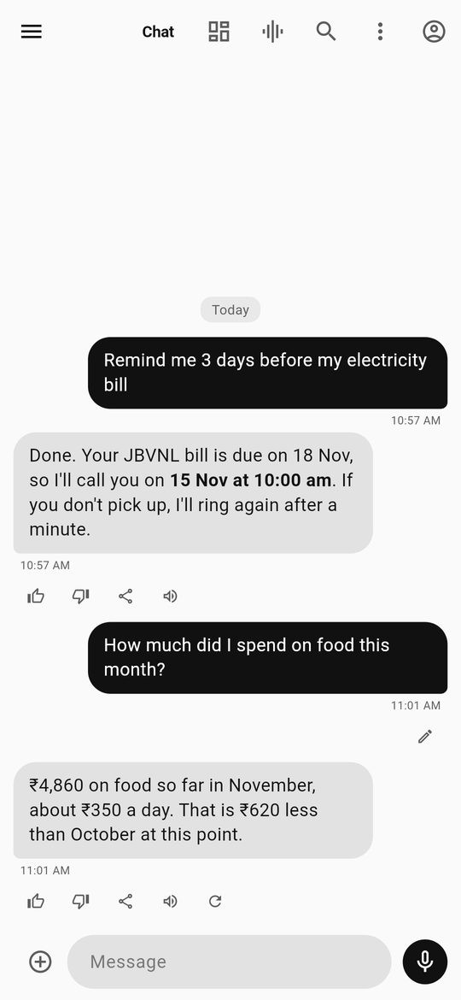
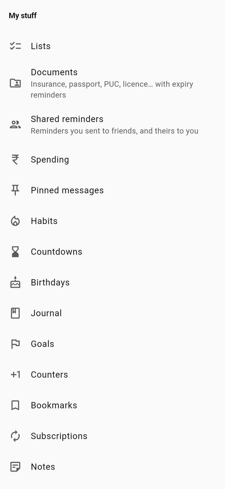
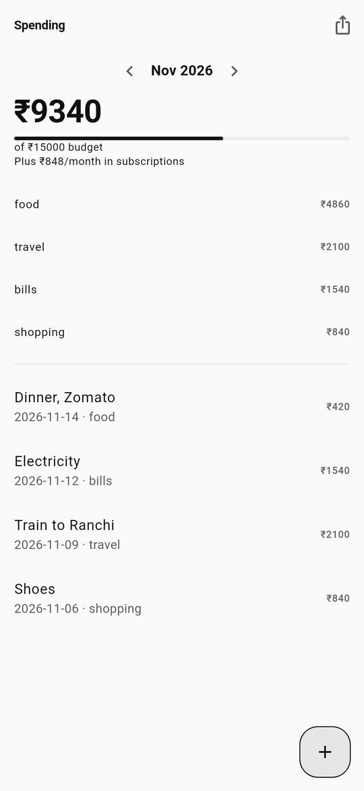

# Jini: a Hindi/Hinglish personal AI agent

> **"Bas bolo. Jini kar dega."** (Just say it. Jini will get it done.)

Jini is an Android-first personal AI agent, built on Gemini, that understands **English, Hindi and Hinglish (typed or spoken)**, remembers the user, and **gets everyday tasks done**: bill reminders, mail replies, bookings and more. It always asks for approval before it spends money or sends anything in the user's name.

Designed, built and shipped end to end by a solo founder, **[Abhishek Kumar](https://www.linkedin.com/in/abhishek-jini/)** (Pune, India), under the [WhatsClaw](https://whatsclaw.in) brand.

**Try it:** [jini.whatsclaw.in](https://jini.whatsclaw.in) · **Stage:** MVP / working beta

> 🔒 **About this repository.** This is a public **showcase** repo, with no source code. Jini's source lives in a private repository. **I'm happy to walk through the code, architecture and CI live in an interview, or to grant temporary read access on request.** Contact: [LinkedIn](https://www.linkedin.com/in/abhishek-jini/).

---

## Who it's for

- **Hindi/Hinglish-speaking Android users in India** who run a busy household or a small business from their phone, such as a shop owner or working parent in a Tier 2/3 city.
- **Small-business owners** who juggle bills, dues and customer follow-ups across many English-first apps.
- **Families** who share reminders for a parent's medicines, bills and renewals.

The problem: generic chatbots answer questions but don't finish the job, don't remember the person, and don't speak the Hinglish people actually use. The result is missed due dates, late fees and lost hours.

---

## Key features

| Area | What Jini does |
|---|---|
| 🧠 **Chat that remembers** | Long-term memory of preferences, people and places, **recalled by meaning** (embeddings + pgvector). Users can view and delete every memory. |
| ⏰ **Reminders that land** | Call-style alerts that ring like a phone call, a morning brief, shared family reminders, plus bill, expense, document-expiry and parcel trackers. |
| 📧 **Mail & calendar** | Summarises Gmail, **drafts replies for approval**, finds free time in Google Calendar. |
| 🌐 **Gets things done on the web** | A **sandboxed cloud-browser agent** fills carts and bookings. The final pay click is **blocked in code until the user approves**, and UPI hands off to the user's own UPI app. |
| 🗣️ **Speaks your language** | Hindi/Hinglish voice notes and voice mode via Gemini audio understanding. Hindi stays in Devanagari, Hinglish in Latin script. Hindi UI option. |
| 🇮🇳 **India tools** | Pincode, IFSC, AQI, and EMI/SIP/GST calculators. |
| 📄 **Deliverables** | Generates designed PDF reports and slide decks (with charts and previews) from chat. |
| 🛠️ **Agent workspace** | A per-user isolated Linux workspace and a coding sub-agent that plans, writes, runs and fixes small projects, with every push or publish behind an approval card. |
| ✅ **Approval-first** | Nothing is paid, sent or booked in the user's name without a tap on an approval card. Auto-spend defaults to zero. |

---

## Architecture

**Design choices worth discussing in an interview:**

- **Tiered model routing.** Each turn is rated simple, standard or hard. Light models (Flash-Lite) take simple turns, harder turns escalate, and a model that errors, fails tool calls twice or returns empty output hands the turn to the next model in the chain. Quota errors cool a model down so traffic goes straight to one that still has quota. This keeps cost per user low enough for Indian price points.
- **Read in parallel, write one at a time.** Read-only tools run concurrently. Actions that change the world are serialised and pass through the approval gate.
- **Self-checking answers.** Jini self-briefs before long tasks and re-checks replies (arithmetic and dates are recomputed) before they're saved, with an optional source-grounded fact-check pass.
- **Reliability under bad networks.** Each chat reply runs as a server-side job, so leaving the app doesn't kill it. Client retries are de-duplicated with a per-message ID, so a re-send never creates a second turn.
- **Isolation.** Each user's browser and workspace run in separate locked-down containers (non-root, no capabilities, resource caps), with no server secrets inside.

---

## Tech stack

| Layer | Technologies |
|---|---|
| Mobile app | Flutter (Android first; web and iOS builds compile), Google Play Billing |
| Backend | Python, FastAPI, Docker / Docker Compose, Caddy (HTTPS) |
| AI | Gemini API via Google AI Studio (Flash, Flash-Lite, embeddings, audio understanding, function calling); Groq fallback; optional OpenRouter / Anthropic |
| Memory & data | Supabase Postgres + pgvector (row-level security) |
| Auth & push | Firebase Authentication (ID tokens verified server-side), Firebase Cloud Messaging |
| Agents & sandboxes | Per-user containers for the cloud browser, Linux workspace and coding sub-agent |
| Integrations | Gmail, Google Calendar, WhatsApp webhook, UPI handoff; connectors for MS365, Slack, Notion, Todoist, MCP |
| CI/CD | GitHub Actions (backend tests, Flutter build + APK, sandbox tests, web and iOS builds, scheduled jobs) |

---

## Engineering proof

| Signal | Result |
|---|---|
| **Automated tests in CI** | **1,111 passing**: 903 backend + 208 Flutter (as of app v0.79.1, Nov 2026) |
| **AI evaluation set** | **34 cases**: **33/34** on practice (mock) runs. **First live Gemini run: 30/34**; the failing groups were then fixed to 5/5. |
| **Release cadence** | 75+ versioned releases with written changelogs (private repo, currently v0.83) |
| **Privacy-first ops** | Owner admin panel tracks retention and reply speed **without reading chat content**. Request IDs on every call; chat contents are never logged. |
| **Safety by default** | Approval cards for money and messages, auto-spend at zero, pay click blocked in code, UPI handoff. |

> 🕒 **Coming soon:** a CI run screenshot and the eval results table.
<!-- TODO: docs/ci-run.png (or a CI badge), docs/eval-results.png -->

---

## How I build: AI-first, with agentic tooling

I'm an **AI-first builder**. I don't hand-write code line by line. I design the product and the system, then direct LLMs and agentic coding tools to build it:

1. **Spec first.** I write the feature spec, constraints, tool schemas and a success check.
2. **Generate with agents.** Agentic coding tools and LLMs write the code against that spec.
3. **Verify, don't trust.** Every change has to pass the CI test suite (1,111 tests) and the AI eval set. Regressions get a guard test.
4. **Ship small and often.** 75+ versioned releases, each with a changelog. Owner rules (security first, approval before action, "no silent failures") are written down and enforced in tests.
5. **Stay lean.** Free and low-cost tiers by default (free Gemini tier, Supabase, a free-tier VM, GitHub Actions), with paid models only where they add value.

My background is 10+ years of industrial operations and electrical engineering (L&T, Vision Infra). I build for real-world messiness, not demos.

---

## Screenshots

| Onboarding | Chat (reminder + spend recall) | "My stuff" hub | Spending tracker |
|---|---|---|---|
|  |  |  |  |

> 🕒 **More screens coming soon:** the approval card before a payment, the cloud-browser live view, a generated deck/PDF card, and a Hindi/Hinglish voice-note reply.
<!-- TODO: docs/screenshot-approval-card.png, docs/screenshot-cloud-browser.png, docs/screenshot-deck-card.png, docs/screenshot-hindi-voice.png -->

## Demo video

> 🎬 **Demo video coming soon:** a 2–3 minute walkthrough of a Hinglish voice reminder, recall by meaning the next day, a Gmail draft waiting for approval, and the cloud browser stopping at the approval card.
<!-- TODO: demo video URL + docs/demo-thumbnail.png -->

---

## Roadmap

Honest status: the items below are **planned, not live**.

- **Google Cloud move.** Deploy the API to Cloud Run in Mumbai (asia-south1), store secrets in Secret Manager, and add Cloud Logging and Monitoring.
- **Vertex AI.** Move production Gemini traffic to Vertex AI for quotas, monitoring and no training on user data. Today Jini uses a free AI Studio key.
- **Managed Postgres.** Move memory and data from Supabase to Cloud SQL for PostgreSQL with pgvector (AlloyDB as it grows), keeping row-level security.
- **Payments hardening.** Turn off card storage.
- **WhatsApp scope.** Use WhatsApp only for alerts and approvals, keeping conversation in the app.
- **Flagship flow.** Ship "Bills & medicines for families" end to end in Hindi/Hinglish, measuring latency, cost per task and eval pass rate.

---

## Links

- 🌐 Jini: [jini.whatsclaw.in](https://jini.whatsclaw.in)
- 🏢 WhatsClaw: [whatsclaw.in](https://whatsclaw.in) (also the founder's live Play Store app, [WhatsClaw Auto Reply Scheduler](https://play.google.com/store/apps/details?id=com.whatsclaw.app), 1,000+ organic installs)
- 💼 LinkedIn: [linkedin.com/in/abhishek-jini](https://www.linkedin.com/in/abhishek-jini/)

**Source code:** private. Available on request for interviews (live walkthrough or temporary read access).

---

Facts in this README come from the Jini pitch deck (Nov 2026) and the private repo's README and changelog. Test and eval numbers are as of app v0.79.1. Jini user, revenue and install numbers are not claimed here; the 1,000+ installs belong to the separate WhatsClaw app.
